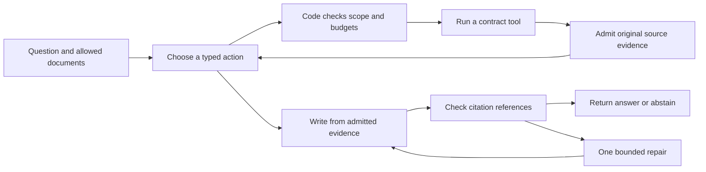

# Understand the contract agent

Reviewed 2026-10-01. This guide explains the current project in plain language. The
[documentation map](README.md) links to the exact specifications and reports.

## What the project does

The project answers questions about a selected set of contracts. It finds original
passages, can look up a referenced clause or definition, can perform calendar-date
arithmetic, and writes an answer with references back to the source. It keeps a record
of how it reached the answer.

For example, a contract may require insurance while a product is tested or sold. A
useful answer must find the insurance clause, preserve any conditions, and avoid
inventing amounts redacted as `[***]`.

The local corpus contains 56 documents and 6,270 chunks: 40 CUAD agreements, 10
ContractNLI NDAs, and six labelled synthetic variants. A chunk is a passage extracted
from a document, with its original document and location metadata. The 41 evaluation
questions are a separate question bank, not the number of contracts or chunks.

## Follow one question

LangGraph controls these transitions. The model proposes actions; Python decides
whether the arguments, document scope, snapshot, remaining budget, and evidence are
acceptable. The graph prevents a draft from becoming a final answer before the
mandatory citation check.

The five tools are document search, clause retrieval, definition lookup, date
calculation, and citation verification. MCP exposes the same tools to an external
client through a local stdio server. Both callers use the same executor. However,
the external client controls its own final answer and can skip verification; the
graph's final-answer guarantee does not transfer to MCP clients.

## Why both 36 and 41 appear

They are not two different test sets. Both refer to the frozen `hand-v1` question bank.

| Expected behavior | Cases | What a good response does |
|---|---:|---|
| Answer | 35 | Answers using the required visible evidence |
| Partial answer | 1 | Answers the supported part and identifies what cannot be determined |
| Abstain | 5 | Says the available evidence does not support an answer |
| Total | **41** | Evaluates answering, partial answering, and refusal |

**36 = 35 answer cases + 1 partial case.** These have target evidence to retrieve.
**41 = 36 evidence-bearing cases + 5 expected abstentions.**

The partial case compares contracts including a heavily redacted one. The system
should compare visible terms and explain which hidden details cannot be determined.
It is not expected to invent the missing text.

Retrieval evaluation uses 36 cases because the other five have no target passage to
find. Including them as retrieval successes would artificially improve recall. End-to-end
evaluation uses all 41 because knowing when to refuse is part of the system's behavior.

The questions cover direct lookup, cross-document comparison, cross-references,
refinement, conflicting versions, unsupported claims, distractors, prompt injection,
and unanswerable queries. They are author-written/reviewed development cases used
while building the system, not an unseen final exam.

## What evaluation is doing

Evaluation asks several different questions about the same system. Passing one does
not imply passing the others.

| Check | Plain-language question | What it cannot establish |
|---|---|---|
| Software tests (`pytest`) | Do permissions, counters, parsers, graph routes, and exporters behave as coded? | Whether a real model understands a contract |
| Retrieval experiment | Did the selected passages contain the annotated evidence? | Whether the model used that evidence correctly |
| Structural citation check | Does each reference resolve to an allowed, admitted source passage? | Whether the passage supports the statement |
| Claim-support judge | Does a factual statement follow from its own cited excerpts? | Whether the answer includes every important condition |
| Answer-quality review | Is the whole answer correct, sufficiently complete, and appropriate to the question? | Broad performance outside this small development suite |
| Operational measurement | How many calls/tokens and how much time did execution use? | Answer correctness |

A software test count is not a question-bank size. For example, 64 focused unit tests
can test implementations that later run over 41 evaluation questions. An individual
question may involve several model calls, tool calls, and grader calls.

### A small example

Suppose an invented contract says: "Maintain liability insurance during trials and
commercial sales; the coverage amount is [***]."

If retrieval finds that passage, retrieval succeeds. If an answer cites that real
passage but says the amount is $10 million, its citation may be structurally valid
while its claim is unsupported. If an answer mentions trials but omits sales, its
individual claim might be supported while the whole answer is incomplete. A good
answer covers both periods and says the amount is redacted.

This is why retrieval, citation structure, semantic support, and complete-answer
quality need separate checks.

## Understand the recall number

The CV result, **45.8% to 72.7% evidence recall@5**, comes from the 36 evidence-bearing
development cases. `@5` means only the final five original source chunks are inspected.
The metric checks a normalized 60-character probe from each annotated evidence span
inside chunks from the correct document. It locates evidence; it does not require
recovering every word of the full annotated passage.

Each question first receives a fraction of expected evidence found. Those fractions
are averaged equally across questions. If one question needs two passages and only
one is found, it scores 50%. If another needs one and it is found, it scores 100%.
The two-question average is 75%. Therefore, 72.7% does not mean that 72.7% of questions
were fully answered correctly.

The stricter complete-span development metric is 68.5%. The 119-question CUAD
validation scores 71.8% on the evidence-location metric, versus 70.2% for the previous
hybrid reranker. That newer incremental gain is modest and statistically uncertain.
Read [the retrieval report](retrieval-improvement-results.md) for ablations and failures.

One historical detail matters when reading tables: old B–D reports averaged retrieval
grades across all 41 cases, including no-evidence `1.0` placeholders. Those placeholders
mean "not applicable," not proven retrieval success. Do not directly compare that
aggregate with the 36-case retrieval experiment. Current V2 diagnostics represent
expected-abstention evidence recall as null. See [metric definitions](eval-methodology.md).

## Which question sets exist

| Name or count | Purpose | How to interpret it |
|---|---|---|
| `hand-v1`: 41; retrieval subset: 36 | Main author-reviewed development question bank | Same bank, different metric denominators |
| A limited run of `hand` | Quick wiring checks using a script's `--limit` option where supported | A subset of hand-v1, not a separate checked-in question bank |
| Judge split: 20 + 21 | Calibrate a judge on 20 cases, audit it on 21 | A partition of the same 41; not 41 new questions or independent validation of the agent |
| `provisional-generated-v2-1`: 24 | Exercise newer tool capabilities and unsupported inputs | Generated fixtures; report separately, not as validated capability results |
| `cuad-source-questions-v1`: 119 | Validate retrieval on original CUAD questions from 23 development-disjoint contracts | Templated clause extraction, not conversational or cross-document answer quality |
| `answerability`: 20 | Supplemental answer/refusal diagnostics | Provisional generated cases; not the five abstentions from hand-v1 |
| `full`: 41 | Historical provisional generated question collection, superseded by hand-v1 | Same size as hand-v1, but different cases/review status; not headline or CV quality data |

[Dataset READMEs](../evals/datasets/README.md) record versions and provenance. Do not
pool these banks into a single larger score: they have different purposes and review status.

## What has actually been measured

- Retrieval comparisons and the later query-expansion validation have recorded results.
- Historical V1 answer/citation/answerability experiments exist in `results/`. They
  do not establish that the current V2 answers are better.
- Offline V2 runs check routes, tools, evidence handling, and failure behavior. Stub
  planner/writer outputs are simulated and cannot measure contract understanding.
- The standalone V2 runner and review infrastructure are implemented. **No completed
  live V2 answer-quality evaluation is reported.**
- OTLP tests prove the exporter can send traces to a local test receiver. They do not
  prove that a particular Langfuse cloud project has received a trace.

## How the current V2 evaluation would run

1. Freeze the question bank, model/configuration, corpus, code revision, and budgets.
2. Run V2 on all 41 cases, saving each case and its local trace. Resume the batch
   without repeating completed cases if it is interrupted.
3. Have a human review the 41 answers, including the partial and refusal cases, then
   freeze those labels before exposing LLM-judge verdicts.
4. Calibrate the claim-support and answer-rubric judges on the 20 calibration cases:
   inspect their agreement with the already frozen human labels, review mistakes,
   and revise/recalibrate if needed. Use the label tool to expose calibration verdicts;
   do not manually open sealed files or expose the 21 audit cases to tuning. Freeze
   the judges before the 21-case judge audit. The final frozen pass covers all 41,
   but calibration agreement is reported separately from audit agreement.
5. Report human answer-quality labels, judge mistakes/agreement, structural checks,
   and operational costs separately. Failed executions cannot count as good refusals.

The current answer-rubric prompt remains provisional and requires author review before
a live frozen pass. The 20/21 split evaluates the judges; it does not turn the old
development questions into an unseen benchmark. See [the executable protocol](evaluation_protocol.md#standalone-v2-evaluation-hand-v1).

## Connect this to your CV and interview

| CV topic | What to demonstrate | What to explain |
|---|---|---|
| LangGraph and MCP | Follow the UI route; inspect the shared executor and MCP demo | The graph orchestrates; MCP exposes tools; code authorizes actions |
| Hybrid retrieval | Open an evidence card and compare retrieval arms | BM25 matches words, embeddings match meaning, RRF merges ranks, cross-encoder reranks |
| Execution controls | Inspect evidence admission, citation checks, and budget counters | A valid reference is not proof of semantic correctness; repair and refusal are bounded |
| Langfuse and evaluation | Match a local run to its exported trace; read a case report | Telemetry explains execution; evaluation judges quality; their results stay separate |

Start with [the UI and Langfuse walkthrough](ui-langfuse-walkthrough.md). After observing
one run, practice this explanation: "I separate finding evidence, validating references,
checking factual support, and reviewing the complete answer. The 36 retrieval cases
are the evidence-bearing subset of my 41-case development suite. I have retrieval
measurements and implemented V2 evaluation infrastructure, but no final live V2
answer-quality result yet."
